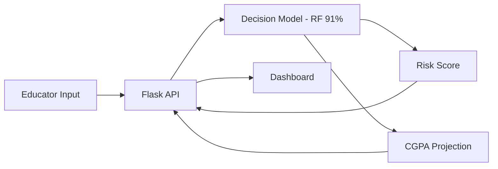

# 🎓 AI Grade Prediction

**An intelligent, data-driven system to predict student academic risk using ML.**

---

## 🏗️ System Architecture

## 🚀 Quick Start
Run standalone `.exe` distributable or `python app/app.py`.
