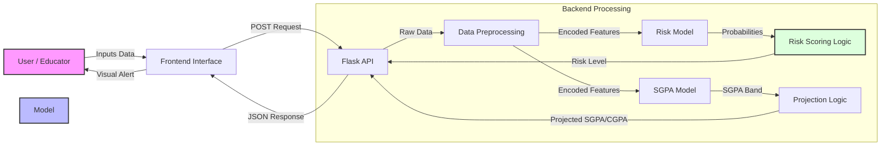

<div align="center">
  
  
  <br/>
  
  
  
  
</div>


# 🎓 AI Grade Prediction


**An intelligent, data-driven system to predict student academic risk using Machine Learning.**
*Empowering educators with early warning signals to improve student success rates.*


👉 **[Read the Full Project Report & Whitepaper](docs/summary.md)**

---

## 🚀 Key Features

*   **📊 Predictive Analytics**: Utilizes **Random Forest** (91% Accuracy) to classify students into Low, Medium, or High risk categories.
*   **🔮 Academic Forecasting**: Predicts future **SGPA Bands** and projects **CGPA** using deterministic academic logic.
*   **🧠 Intelligent Scoring**: Generates a precise **Risk Score** and **Confidence Level** for actionable insights.
*   **🎨 Professional Interface**: A clean, academic dashboard designed for decision support.
*   **📦 Portable Deployment**: Fully packaged standalone `.exe` for instant use on any Windows machine.

---

## 📸 Screenshots

### Risk Assessment Results


---

## 🏗️ System Architecture



---

## 📂 Project Documentation

We have detailed documentation available in the `docs/` folder:

*   **[📄 Project Summary](docs/summary.md)**: Detailed whitepaper and system overview.
*   **[🚀 Development Steps](docs/development_steps.md)**: A step-by-step log of how this project was built.
*   **[🛠️ How to Run](docs/how_to_run.md)**: Comprehensive guide for developers and users.
*   **[🌳 Project Tree](docs/project_tree.md)**: File structure visualization.

---

## 🚀 Quick Start

### 👨‍💻 For Users (No Coding Needed)
1.  Go to the `dist/` folder.
2.  Double-click **`student_risk_predictor.exe`**.
3.  The application will launch in your browser automatically at `http://127.0.0.1:5000`.

### ⚙️ For Developers
1.  **Clone the repository**:
    ```bash
    git clone https://github.com/MrRenntech/AI-Grade-Prediction.git
    ```
2.  **Install dependencies**:
    ```bash
    pip install -r requirements.txt
    ```
3.  **Run the application**:
    ```bash
    python app/app.py
    ```

---

## 🤖 Model Performance

We evaluated multiple models to ensure the highest reliability:

| Model | Accuracy | Precision | Recall | Verdict |
| :--- | :--- | :--- | :--- | :--- |
| **Random Forest** | **91.1%** | **0.90** | **0.92** | **Selected 🏆** |
| Logistic Regression | 84.8% | 0.83 | 0.85 | Baseline |

---

## 🤝 Contributing

Contributions are welcome! Please fork the repository and submit a pull request.

---

*Built with ❤️ for Educational Technology.*