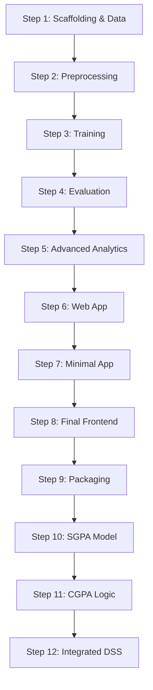

# 🚀 Development Steps - Student Performance AI

This document outlines the step-by-step process used to build this project.

## 🏗️ Step 1: Project Scaffolding & Data Setup
1.  **Created the project directory structure**:
    - `data/` for datasets.
    - `src/` for source code (preprocessing, training, evaluation).
    - `models/` for saved models.
    - `app/` for the web application.
    - `notebooks/` for experimental notebooks.
2.  **Added the dataset**: `student-mat.csv` to the `data/` folder.
3.  **Dependencies**: Created `requirements.txt` with pandas, numpy, scikit-learn, matplotlib, seaborn, flask, joblib.

## 🧹 Step 2: Data Preprocessing
1.  Created `src/data_preprocessing.py`.
2.  Implemented `load_and_preprocess()` function to:
    -   Load data from CSV.
    -   Combine **G1** and **G2** grades into a new feature `G1_G2_AVG`.
    -   Define the target variable **Risk** (1 if G3 < 10, else 0).
    -   Drop the original `G3` column to prevent data leakage.
    -   Encode categorical variables using **One-Hot Encoding**.
    -   Scale numerical features using **StandardScaler**.
    -   Handle class imbalance using **SMOTE** (Synthetic Minority Over-sampling Technique).

## 🤖 Step 3: Model Training & Evaluation
1.  **Data Splitting**:
    -   Split the dataset into Training (80%) and Testing (20%).
    -   Used `stratify=y` to ensure consistent "At-Risk" vs "Safe" proportions.

2.  **Model Selection & Training**:
    -   We trained and compared two distinct algorithms:
        -   **Logistic Regression**: A linear model used as a baseline.
        -   **Random Forest Classifier**: An ensemble learning method (200 trees) handling non-linear relationships.

3.  **Performance Results**:
    -   **Logistic Regression**: ~**84.8% accuracy**.
    -   **Random Forest**: ~**91.1% accuracy**.
    -   *Why Random Forest?* Superior performance due to ability to model complex decision boundaries.

4.  **Model Serialization**:
    -   Saved best model to `models/student_risk_model.pkl` using `joblib`.

## 📊 Step 4: Model Evaluation
1.  Created `src/evaluate_model.py`.
2.  Generated performance metrics:
    -   **Confusion Matrix**: Visualize true vs. false predictions.
    -   **Classification Report**: Precision, Recall, F1-Score.
    -   **ROC-AUC Score**: Measure ability to distinguish classes.
3.  Plotted **ROC Curve** to `models/roc_curve.png`.

## 🧠 Step 5: Advanced Analytics (Risk Scoring & Explainability)
1.  **Risk Scoring (`src/risk_scoring.py`)**:
    -   Implemented probability-based scoring using `predict_proba()`.
    -   **High Risk**: Probability >= 0.75 (Immediate intervention).
    -   **Moderate Risk**: Probability 0.50 - 0.75 (Monitor).
    -   **Low Risk**: Probability < 0.50.
2.  **Feature Importance (`src/feature_importance.py`)**:
    -   Extracted importance scores from Random Forest.
    -   Created visualization at `models/feature_importance.png`.

## 🌐 Step 6: Web Application Prediction System
1.  **Backend (`app/app.py`)**:
    -   Initialized Flask.
    -   Loaded model and encoders.
    -   *Crucial*: Ensured consistent preprocessing using saved `LabelEncoder`.
2.  **Frontend (`app/templates/index.html`)**:
    -   "Rich Aesthetics" dark-mode interface.
    -   AJAX for seamless predictions.
3.  **Integration**:
    -   Connected frontend to backend.
    -   Displayed dynamic risk alerts.

## 📉 Step 7: Minimal Flask App (Re-implementation)
1.  **Refactoring**: Replaced complex app with minimal, robust version.
2.  **Backend**: Simplified JSON payloads, robust error handling.
3.  **API Verification**: Verified `/predict` endpoint.

## 🎨 Step 8: Final Frontend Implementation
1.  **Form-Based Interface**:
    -   Inputs: Age, Study Time, Absences, Average Grade.
    -   Dynamic risk visualization (Low/Medium/High).
    -   Details: Risk Score, Confidence, Probability Breakdown, Recommended Actions.

## 📦 Step 9: Packaging & Deployment
1.  **Executable Generation**:
    -   Used **PyInstaller** to package Flask app.
    -   `python -m PyInstaller ... --onefile app/app.py`
2.  **Documentation**: Updated `PROJECT_TREE.txt` and `HOW_TO_RUN.txt`.

## 🔮 Step 10: SGPA Prediction Model (Step B)
1.  **Data Strategy**: Simulated SGPA bands based on G3.
2.  **Model Training**: Trained Random Forest (`src/train_sgpa_model.py`) on pre-final inputs.
3.  **Accuracy**: ~67% for 5-class banding.

## 📈 Step 11: CGPA Projection Logic (Step C)
1.  **Formula**: `((Current CGPA * Completed Semesters) + Projected SGPA) / (Completed Semesters + 1)`.
2.  **Band Mapping**: Conservative mapping (e.g., Band 3 -> 8.5).

## 🏆 Step 12: Integrated Decision Support System (Step D)
1.  **Backend Integration**: Parallel execution of Risk + SGPA models.
2.  **Frontend Upgrade**: "Academic Report" style view with unified metrics.
