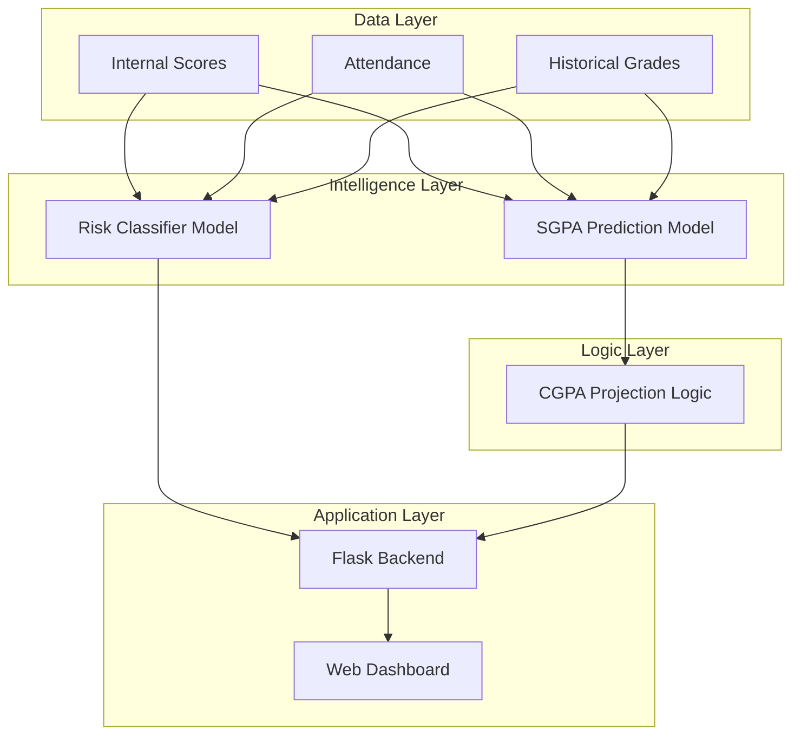

# 🎓 AI-Based Student Performance Prediction and Academic Forecasting System


## 1. Project Overview

This project presents an **AI-driven decision-support system** designed to assist educational institutions in identifying academically at-risk students and forecasting future academic performance. Unlike traditional systems that rely solely on final examination results, this system uses continuous assessment data, historical academic performance, and behavioral indicators to generate **early warnings**, **semester performance predictions (SGPA)**, and **cumulative performance projections (CGPA)**.

The system is intended for **faculty members, academic advisors, and institutions** to support timely intervention and informed academic decision-making. Predictions are strictly advisory and are designed to complement, not replace, human judgment.

---

## 2. Motivation and Problem Statement

In most universities, student performance is evaluated only after final examinations, leaving little scope for early corrective action. Students who begin to struggle mid-semester often go unnoticed until it is too late to intervene effectively.

### The Core Problems:
*   ❌ **Lack of early identification** of academically at-risk students.
*   ❌ **Absence of predictive insights** during an ongoing semester.
*   ❌ **No structured way to estimate** future academic outcomes (SGPA/CGPA) before completion.

This project aims to bridge this gap by applying **machine learning** and **academic domain logic** to provide actionable insights well before final examinations.

---

## 3. Key Objectives

1.  🎯 **Early Risk Prediction**: Identify students efficiently using AI.
2.  🔮 **SGPA Forecasting**: Predict expected semester performance using internal assessments.
3.  📈 **CGPA Projection**: Estimate future academic standing.
4.  🤖 **Deployment**: Integrate ML models into a robust Flask backend.
5.  🖥️ **Decision Support**: Present insights in a faculty-friendly dashboard.
6.  ⚖️ **Ethical AI**: Ensure fair and advisory use of data.

---

## 4. Academic Structure & Assumptions

The system aligns with a standard university academic structure:

*   **Mid-Sem / Internal Exams**: Early indicators.
*   **End-Sem Exams**: Final validation.
*   **SGPA (Semester Grade Point Average)**: Current term performance.
*   **CGPA (Cumulative Grade Point Average)**: Overall academic standing.

> **Note**: Predictions are made *before* end-sem examinations, using only data available mid-semester.

---

## 5. System Architecture

The system is divided into clearly defined layers:



### 5.1 Data Layer
*   Academic scores (Internal/Mid-sem)
*   Attendance & Behavioral metrics
*   Historical context (Prior SGPA/CGPA)

### 5.2 Intelligence Layer (ML)
*   **Risk Model**: Classifies student status.
*   **SGPA Model**: Predicts grade bands.

### 5.4 Backend & Frontend
*   **Flask API** for real-time inference.
*   **Professional Dashboard** for advisors.

---

## 6. Machine Learning Models

### 6.1 Academic Risk Prediction Model 🚨
*   **Type**: Supervised Classification (Random Forest)
*   **Target**: Risk Level (Low / Medium / High)
*   **Accuracy**: ~91%
*   **Inputs**: Internal marks, absences, study time.

### 6.2 SGPA Prediction Model 📊
*   **Type**: Band-based Classification
*   **Bands**: `< 6.0`, `6.0-7.0`, `7.0-8.0`, `8.0-9.0`, `≥ 9.0`
*   **Why Bands?**: Provides robust, interpretable ranges rather than precise, potentially misleading decimals.

---

## 7. CGPA Projection Logic

Projections use determinist academic formulas, ensuring transparency.

```math
\text{Projected CGPA} = \frac{(\text{Current CGPA} \times \text{Completed Sems}) + \text{Predicted SGPA}}{\text{Completed Sems} + 1}
```

*Note: Predicted SGPA is derived from the midpoint of the predicted band.*

---

## 8. Early Warning & Decision Support

The system converts raw predictions into **actionable insights**:

| Risk Level | Visual Indicator | Recommendation |
| :--- | :--- | :--- |
| **High Risk** | 🔴 Red | Immediate Intervention Required |
| **Medium Risk** | 🟡 Yellow | Close Monitoring Suggested |
| **Low Risk** | 🟢 Green | No Immediate Concern |


---

## 9. Technology Stack

| Component | Technology |
| :--- | :--- |
| **Language** | Python 3.8+ |
| **ML Framework** | Scikit-Learn |
| **Backend** | Flask |
| **Frontend** | HTML5, CSS3, JavaScript |
| **Persistence** | Joblib |
| **Visualization** | Matplotlib |

---

## 10. Ethical Considerations
*   **Advisory Only**: Tools support humans, they don't replace them.
*   **Privacy**: Designed to work with anonymized IDs.
*   **Bias Awareness**: Confidence thresholds prevent false certainty.

---

## 11. Conclusion

This project demonstrates how **Artificial Intelligence**, when combined with **Academic Domain Knowledge**, can significantly enhance educational decision-making. By focusing on **early warning**, **interpretability**, and **academic realism**, the system moves beyond traditional grade prediction and provides meaningful support for students and educators alike.

---
*Generated for the Sem 8 Project Documentation*
